# C++ Learning & Revision Roadmap

This roadmap establishes the optimal learning and revision order based on **strict prerequisite dependencies** between C++ concepts. 

Attempting to learn smart pointers before mastering raw pointers and object lifetimes leads to confusion regarding what problem smart pointers actually solve. Follow this ordered pathway for the most efficient revision experience.

---

## Prerequisite Dependency Graph

```mermaid
flowchart TD
    subgraph Phase1["Phase 1: Foundations"]
        A["1. Variables, Types & Memory Layout"] --> B["2. Strings & Character Operations"]
        B --> C["3. References & Const Correctness"]
    end

    subgraph Phase2["Phase 2: Memory Architecture"]
        C --> D["4. Stack vs. Heap & Lifetimes"]
        D --> E["5. Raw Pointers & Pointer Arithmetic"]
        E --> F["6. Dynamic Allocation & Memory Hazards"]
    end

    subgraph Phase3["Phase 3: Object-Oriented Programming"]
        F --> G["7. Classes & Encapsulation"]
        G --> H["8. Shallow vs. Deep Copy (Rule of 3/5)"]
        H --> I["9. Inheritance & Composition"]
        I --> J["10. Dynamic Polymorphism & Virtual Functions"]
    end

    subgraph Phase4["Phase 4: Modern Memory Safety & STL"]
        J --> K["11. RAII & Smart Pointers (unique_ptr, shared_ptr)"]
        K --> L["12. Sequential Containers (vector, stack, queue)"]
        L --> M["13. Associative Containers (unordered_map, set)"]
        M --> N["14. Priority Queues & Heaps"]
        N --> O["15. Iterators & STL Algorithms"]
    end

    subgraph Phase5["Phase 5: Advanced C++ & System Synthesis"]
        O --> P["16. Generic Programming & Templates"]
        P --> Q["17. Lambdas & Closures"]
        Q --> R["18. Exception Handling & Stack Unwinding"]
        R --> S["19. File Streams (fstream, sstream)"]
        S --> T["20. Capstone Architecture: Library Management"]
    end

    subgraph Phase6["Phase 6: Algorithmic Patterns"]
        T --> U["21. LeetCode Problem Patterns"]
    end
```

---

## Detailed Study Phases & Learning Milestones

### Phase 1: Core Fundamentals
- **Prerequisites**: None.
- **Focus**: How data is represented in physical bytes, string operations, and references as aliases.
- **Docs to Read**:
  1. [Variables, Fundamental Types, and Memory Representation](../docs/01-cpp-fundamentals/01-variables-types-memory.md)
  2. [Strings and Character Manipulation](../docs/01-cpp-fundamentals/02-strings-and-char-manipulation.md)
  3. [References and Const Correctness](../docs/01-cpp-fundamentals/03-references-and-const.md)

### Phase 2: Memory Management & Pointer Mechanics
- **Prerequisites**: Understanding of types and memory addresses.
- **Focus**: The physical difference between the Stack and the Heap, pointer arithmetic, and the hazards of raw `new`/`delete` (leaks, dangling pointers, double frees).
- **Docs to Read**:
  1. [Memory Architecture: Stack vs. Heap and Object Lifetimes](../docs/02-memory-management/01-stack-vs-heap.md)
  2. [Pointers and Pointer Arithmetic](../docs/02-memory-management/02-pointers-and-pointer-arithmetic.md)
  3. [Raw Dynamic Memory Allocation & Safety Hazards](../docs/02-memory-management/03-dynamic-allocation-raw.md)

### Phase 3: Object-Oriented Programming (OOP)
- **Prerequisites**: Memory management and references.
- **Focus**: Invariants, deep copies vs shallow copies (Rule of Three/Five), inheritance vs composition, and virtual table dispatch.
- **Docs to Read**:
  1. [Classes and Encapsulation](../docs/03-object-oriented-programming/01-classes-and-encapsulation.md)
  2. [Deep Copy vs. Shallow Copy & Rule of Three / Five](../docs/02-memory-management/05-deep-vs-shallow-copy.md)
  3. [Inheritance vs. Composition](../docs/03-object-oriented-programming/02-inheritance-and-composition.md)
  4. [Dynamic Polymorphism and Virtual Functions](../docs/03-object-oriented-programming/03-polymorphism-and-virtual-functions.md)

### Phase 4: Modern Memory Safety & The Standard Template Library (STL)
- **Prerequisites**: Class destructors and dynamic polymorphism.
- **Focus**: RAII, eliminating raw pointers with `std::unique_ptr` and `std::shared_ptr`, and mastering standard containers.
- **Docs to Read**:
  1. [RAII and Modern Smart Pointers](../docs/02-memory-management/04-raii-and-smart-pointers.md)
  2. [Sequential Containers (vector, stack, queue)](../docs/04-standard-template-library/01-sequential-containers.md)
  3. [Associative Containers (unordered_map, set)](../docs/04-standard-template-library/02-associative-containers.md)
  4. [Container Adaptors & Priority Queues](../docs/04-standard-template-library/03-container-adaptors-and-heaps.md)
  5. [Iterators and Standard Algorithms](../docs/04-standard-template-library/04-iterators-and-algorithms.md)

### Phase 5: Modern C++ Paradigms & System Architecture
- **Prerequisites**: STL containers and basic templates.
- **Focus**: Compile-time code generation, lambda closures, exception-safe programming, file persistence, and multi-file project architecture.
- **Docs to Read**:
  1. [Templates and Generic Programming](../docs/05-advanced-modern-cpp/01-templates-generic-programming.md)
  2. [Modern Lambdas and Functional Predicates](../docs/05-advanced-modern-cpp/02-lambdas-and-functional.md)
  3. [Exception Handling and Error Management](../docs/05-advanced-modern-cpp/03-exception-handling.md)
  4. [File I/O and Stream Processing](../docs/05-advanced-modern-cpp/04-file-io-and-streams.md)
  5. [Capstone Project Architecture: Library Management](../docs/05-advanced-modern-cpp/05-capstone-library-management.md)

### Phase 6: Algorithmic Problem Solving by Patterns
- **Prerequisites**: STL containers and algorithms.
- **Focus**: Pattern recognition for technical interviews and LeetCode problems.
- **Guides to Practice**:
  1. [LeetCode Patterns Master Index](../docs/06-leetcode-patterns/README.md)
  2. [Pattern 01: Arrays and Hashing](../docs/06-leetcode-patterns/01-arrays-and-hashing.md)
  3. [Pattern 02: Two Pointers](../docs/06-leetcode-patterns/02-two-pointers.md)
  4. [Pattern 03: Stacks and Queues](../docs/06-leetcode-patterns/03-stacks-and-queues.md)
  5. [Pattern 04: Heap / Priority Queue](../docs/06-leetcode-patterns/04-heap-and-priority-queue.md)
  6. [Pattern 05: Binary Search & Voting Algorithms](../docs/06-leetcode-patterns/05-binary-search-and-voting.md)
